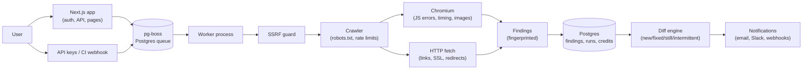

<div align="center">


# UIpocalypse Cloud

**Hosted website monitoring that finds what breaks for your visitors.**

Broken links · JavaScript errors · failed requests · missing images · slow pages · SSL and redirect problems · missing meta tags — with honest reports, history diff, and prepaid credits.

`UIpocalypse Cloud | break it here, not in production`

**Status: all phases (P1–P7) built. Not launched.** The open-source sibling is the local [UIpocalypse](https://github.com/kunalraha-ai/UIpocalypse) QA tool.

[Features](#features) · [Run it](#run-it-locally) · [Architecture](#architecture) · [Security](#security-review) · [Tech stack](#tech-stack)

</div>

---

## Features

- **Crawl + check** — same-origin crawler respects robots.txt and rate limits; 11 check types find broken links (404/5xx/DNS/timeout, with 403/429 external bot-blocking correctly labeled *unverifiable*, not *broken*), JavaScript errors, failed subresource requests, missing images, mixed content, redirect chains and loops, page weight, load timing (load + LCP), SSL expiry, and missing meta tags
- **Honest reports** — findings are fingerprinted (type + normalized URL + normalized message), deduplicated, and ranked by severity with evidence and fix hints. Reports state what was **NOT** checked (skipped pages, robots.txt exclusions, throttled pages, unverifiable external links)
- **History + diff** — runs are compared by fingerprint: **new** / **still failing** / **fixed** (only after 2 consecutive absences) / **intermittent**. Zero phantom changes on identical runs (verified by test)
- **Safe by design** — SSRF guard (27 blocked IPv4+IPv6 ranges, DNS-resolved blocking, rebinding + TOCTOU defense, per-hop redirect re-validation), ownership verification before full crawling (unverified = 1 page, no scheduling), per-user/per-domain/global rate limits
- **Prepaid credits** — append-only ledger, never negative, auto-refund on infrastructure failures, monthly spend caps, low-balance alerts
- **API + CI** — hashed API keys (SHA-256, scoped per project, revocable), signed webhook payloads (HMAC-SHA256), schedules in the user's timezone

## Run it locally

### Quickstart

```bash
git clone https://github.com/kunalraha-ai/UIpocalypse-Cloud.git
cd UIpocalypse-Cloud
docker compose up -d postgres       # Postgres 17 on :5435
cp .env.example .env                # defaults work as-is
npm install
npm run migrate                     # 5 migrations
npm run worker &                    # scan worker (separate process)
npm run dev                         # → http://localhost:4311
```

Open **http://localhost:4311** — the landing page and sign-in render immediately.

### Sign in

To actually sign in, create OAuth apps (the sign-in page honestly says *"not configured"* until you do):

| Provider | Create app | Callback URL |
|---|---|---|
| **GitHub** | [github.com/settings/developers](https://github.com/settings/developers) | `http://localhost:4311/api/auth/github/callback` |
| **Google** | [console.cloud.google.com](https://console.cloud.google.com/apis/credentials) | `http://localhost:4311/api/auth/google/callback` |

Set `GITHUB_CLIENT_ID` / `GITHUB_CLIENT_SECRET` and `GOOGLE_CLIENT_ID` / `GOOGLE_CLIENT_SECRET` in `.env`, restart `npm run dev`, and the sign-in buttons activate.

**Scopes: identity + email only.** Never repository access. Enforced by test.

### Tests

```bash
npm test        # 130 tests (unit + integration against real Postgres)
npx playwright install chromium  # one-time, for the scan-engine tests
```

### LLM mode (optional)

Without an LLM key: fully local, mechanical reports. With a key (`LLM_API_KEY` in `.env`): the optional LLM-written review. The mode is always visible — `LLM mode: on/off, provider, key source` — on every run. Read from the MCP `env` block or `~/.uipocalypse/config` only, never from `.env` files.

## Architecture



The web app **enqueues**; the worker (separate process) **executes**. Nothing heavy runs in the web process.

## What shipped (P1–P7)

| Phase | Shipped |
|---|---|
| **P1 Foundations** | Next.js 15 App Router + TypeScript strict, Postgres + 5 migrations, pg-boss queue + worker, config system (all prices/limits/tiers zod-validated at boot — a bad config refuses to start), GitHub + Google OAuth, CSRF state cookies, opaque server-side sessions (HMAC-signed, constant-time verified), CI |
| **P2 Safety core** | SSRF guard (27 named IPv4+IPv6 ranges, DNS-resolved blocking, rebinding + TOCTOU defense, per-hop redirect re-validation, size/time caps), robots.txt (spec-correct), rate limits (per-user/per-domain/global + concurrency cap), ownership verification, domain denylist + user kill switches |
| **P3 Scan engine** | Same-origin crawler, 11 checks, stable fingerprints, dedupe, fixture site with 10 planted issues + 3 decoys |
| **P4 History + diff** | Fingerprint comparison: new / still-failing / **fixed (2 consecutive absences)** / intermittent / phantom detection; zero phantoms on identical runs |
| **P5 Scheduling + API** | Hashed API keys, schedules, notification settings, HMAC-signed webhooks, email + Slack interfaces |
| **P6 Credits** | Append-only ledger, derived balance, never-negative, spend caps, auto-refund, low-balance alerts |
| **P7 Hardening** | Legal pages (terms, privacy, abuse — placeholder-marked), clean-room setup gate (this README), security review |

## Security review

| Control | Tests | Status |
|---|---|---|
| SSRF: DNS-resolved range blocking, IPv4+IPv6, rebinding, TOCTOU, redirect re-validation | 60 | ✅ trap server records zero hits |
| Auth: OAuth identity+email only, CSRF state, constant-time session verification, fail-closed | 12 | ✅ |
| API keys: SHA-256 hashed, scoped, revocable | 5 | ✅ |
| Webhooks: HMAC-SHA256 signed, constant-time verified | 3 | ✅ |
| Credits: append-only, advisory-lock, never-negative | 7 | ✅ |
| robots.txt: spec-correct parsing, longest-match, crawl-delay | 12 | ✅ |
| Rate limits: per-user, per-domain, global, concurrency cap | 6 | ✅ |
| Ownership: verified vs unverified crawl limits, one owner per domain | 9 | ✅ DB-enforced PK |
| Tenant isolation: all queries scoped by user_id | — | ✅ schema |
| Secrets: never committed (.env gitignored) | — | ✅ |

## Tech stack

| | Layer | Choices |
|---|---|---|
|  | **App** | Next.js 15 (App Router), TypeScript strict, React 19 |
|  | **Runtime** | Node.js 22, pg-boss job queue |
|  | **Browser** | Playwright (Chromium) — page loads, console, network, timing |
|  | **UI** | React 19, self-hosted Inter + JetBrains Mono |
|  | **Database** | PostgreSQL 17 (Docker Compose) |
| | **Auth** | GitHub + Google OAuth (identity + email only) |
| | **Payments** | Abstract interface, test mode only (no real payments) |

## Repository layout

```
src/app/            Next.js pages (landing, sign-in, projects, terms, privacy, abuse)
src/app/api/        API routes (auth, projects, runs)
src/lib/            engine: auth, safe-fetch, crawl, scan, credits, queue
config/             zod-validated app config (all tiers, prices, limits)
migrations/         numbered SQL migrations (001–005)
worker/             the scan worker process (separate from the web app)
test/               130 tests across 16 files
docker-compose.yml  local Postgres
```

## License

MIT — see [LICENSE](./LICENSE).

---

<div align="center"><sub>Break it here, not in production.</sub></div>
