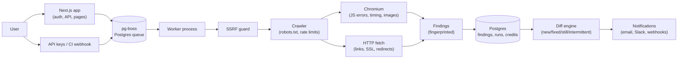

<div align="center">

# UIpocalypse Cloud

**Hosted website monitoring that finds what breaks for your visitors.**

Broken links · JavaScript errors · failed requests · missing images · slow pages · SSL and redirect problems · missing meta tags — with honest reports, history diff, and prepaid credits.

**Status: all phases (P1–P7) built. Not launched.** The open-source sibling is the local [UIpocalypse](https://github.com/kunalraha-ai/UIpocalypse) QA tool.

</div>

---

## Clean-room setup (the P7 gate)

```bash
git clone <this-repo> && cd UIpocalypse-Cloud
docker compose up -d postgres       # Postgres on :5435
cp .env.example .env                # defaults work as-is
npm install
npm run migrate                     # 5 migrations
npm run worker &                     # scan worker (separate process)
npm run dev                          # app → http://localhost:4311
npm test                             # 130 tests
```

To sign in, create OAuth apps (the sign-in page honestly says "not configured" until you do):
- **GitHub**: <https://github.com/settings/developers> — callback `http://localhost:4311/api/auth/github/callback`
- **Google**: <https://console.cloud.google.com/apis/credentials> — callback `http://localhost:4311/api/auth/google/callback`

Both request identity + email only, never repository access.

## What shipped (P1–P7)

| Phase | Shipped |
|---|---|
| **P1 Foundations** | Next.js App Router + TS strict, Postgres + migrations, pg-boss queue + worker process, config system (all prices/limits/tiers zod-validated at boot), GitHub + Google OAuth (identity+email scopes only), CSRF state cookies, opaque server-side sessions (HMAC-signed, constant-time verified), CI |
| **P2 Safety core** | SSRF guard (27 named IPv4+IPv6 ranges, DNS-resolved blocking, rebinding+TOCTOU defense, manual redirect re-validation, response size+time caps), robots.txt parser (spec-correct), rate limits (per-user/per-domain/global token buckets + concurrency cap), ownership verification (meta tag, well-known file; unverified = 1 page, no scheduling), domain denylist + user kill switches |
| **P3 Scan engine** | Same-origin crawler with robots.txt + rate limits, 11 check types (broken-link, js-error, failed-request, missing-image, mixed-content, redirect-chain, redirect-loop, page-weight, load-timing/load+LCP, ssl-expiry, missing-meta), stable finding fingerprints (normalized URL+message with number stripping), dedupe by fingerprint, fixture site with 10 planted issues + 3 decoys |
| **P4 History + diff** | Run comparison by fingerprint: new / still-failing / **fixed (2 consecutive absences)** / intermittent / phantom detection; zero phantom changes on identical runs (verified against real scans) |
| **P5 Scheduling + API** | Hashed API keys (SHA-256, scoped per project, revocable), schedules (hourly/daily/weekly, user timezone, visible last status), notification settings per project, HMAC-signed webhook payloads, email+Slack behind interfaces (stubs in P5; providers arrive at launch) |
| **P6 Credits** | Append-only ledger (grant/purchase/run-charge/refund/expiry/adjustment), balance derived from SUM, never-go-negative (balance + monthly spend cap), auto-refund on infrastructure failures, low-balance at 20% threshold, tier pricing from config (S=3cr, M=10cr, L=30cr) |
| **P7 Hardening** | Legal pages (terms, privacy, abuse report — all honestly marked as placeholders), this README as the clean-room gate, security review below |

## Architecture



## Security review (P7)

| Control | Status |
|---|---|
| SSRF: DNS-resolved range blocking, IPv4+IPv6, rebinding, TOCTOU, redirect re-validation | ✅ 60 tests, trap server records zero hits |
| Auth: OAuth identity+email only, CSRF state, constant-time session verification, fail-closed | ✅ 12 tests |
| API keys: SHA-256 hashed, scoped, revocable | ✅ 5 tests |
| Webhooks: HMAC-SHA256 signed, constant-time verified | ✅ 3 tests |
| Credits: append-only ledger, advisory-lock consistency, never-negative | ✅ 7 tests |
| robots.txt: spec-correct parsing, longest-match, crawl-delay | ✅ 12 tests |
| Rate limits: per-user, per-domain, global, concurrency cap | ✅ 6 tests |
| Ownership: verified vs unverified crawl limits, one owner per domain | ✅ 9 tests + DB-enforced PK |
| Tenant isolation: all queries scoped by user_id | ✅ schema + test |
| Secrets: never committed (.env gitignored) | ✅ |

## Tech stack

| | Layer | Choices |
|---|---|---|
|  | **App** | Next.js 15 (App Router), TypeScript strict, React 19 |
|  | **Runtime** | Node.js 22, pg-boss job queue |
|  | **Browser** | Playwright (Chromium) for page loads, console, network, timing |
|  | **Database** | PostgreSQL 17 |
| | **Auth** | GitHub + Google OAuth (identity+email only) |
| | **Payments** | Abstract interface, test mode only (no real payments) |

## License

MIT — see [LICENSE](./LICENSE).
